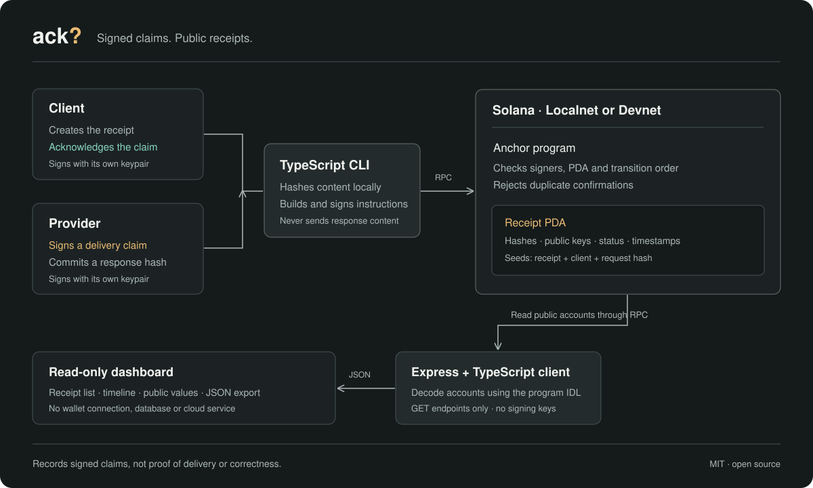

# Architecture

An Anchor program owns the receipt state. The CLI signs transactions. The dashboard only reads accounts.



## One account per receipt

The PDA derives from `receipt`, the client public key and the 32-byte request hash. The client funds its rent at creation. The account stores:

- Client and provider public keys.
- Request and response hashes, each 32 bytes.
- Created, delivered and acknowledged chain timestamps.
- Status, layout version and PDA bump.

The response hash is unset until delivery. Later timestamps are optional until their transitions occur. No API response, keypair or plaintext request is stored.

## Three instructions

```text
Created  →  Delivered  →  Acknowledged
 client      provider       client
```

`create_receipt` initializes the PDA with the signing client and nominated provider. The client and provider must differ. `mark_delivered` requires the stored provider's signature and a nonzero response hash. `acknowledge` requires the stored client's signature after delivery.

Anchor validates account ownership, seeds and signers. Program checks reject duplicate confirmations, invalid ordering and backwards timestamps. There are no reset, close or payment instructions.

## Read path

The Express server reads the configured Localnet or Devnet program through Solana RPC. The TypeScript client decodes accounts using the compiled program's IDL. The browser receives public JSON through these read-only routes:

| Route                               | Result                                              |
| ----------------------------------- | --------------------------------------------------- |
| `GET /api/health`                   | Server health.                                      |
| `GET /api/receipts`                 | Network, program ID, observation time and receipts. |
| `GET /api/receipts/:address`        | A receipt and its source information.               |
| `GET /api/receipts/:address/export` | The same record as a JSON download.                 |

`observedAt` is the server read time. Receipt timestamps come from the program's chain clock. The dashboard retains its previous read in memory if refresh fails and marks it stale.

No database, browser signing, server keypair, cloud storage or paid API is required. Mainnet is intentionally unsupported in this MVP.

## Trust boundary

An on-chain signature attributes a claim to a public key. It does not establish delivery or correctness. The dashboard reports the accounts returned by its configured RPC; it does not independently verify consensus. Public hashes may reveal predictable content through guessing.

See the [guide](guide.md) for the workflow and [Devnet setup](devnet.md) for an optional deployment.
